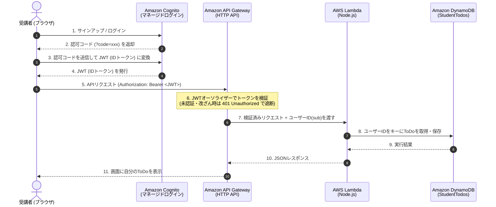

# AWSサーバーレス認証ハンズオン：自分だけのToDoアプリを作ろう

## 1. ハンズオンの目的とゴール
このハンズオンでは、AWSのサーバーレスサービスを組み合わせて**「ログインしたユーザーだけが自分のToDoを読み書きできるWebアプリ」**を構築します。

### 学べること
* **認証（Authentication）：** Amazon Cognitoを使ったユーザー登録・ログインと、認可コード（PKCE方式）によるJWT（JSON Web Token）の発行
* **認可（Authorization）：** Amazon API Gatewayによるトークン検証（未認証アクセスのブロック）
* **データ分離：** AWS LambdaとAmazon DynamoDBを使い、JWTに含まれるユーザー固有ID（`sub`）に紐づくデータだけを操作する仕組み

### システム構成とデータフロー


### 前提条件
* AWSアカウントにログイン済みであること（リージョンは **東京 `ap-northeast-1`** に統一してください）
* PCにテキストエディタとWebブラウザ（Google Chromeなど）があること

---

## 2. Step 1: データベースの作成（Amazon DynamoDB）

まずは、ユーザーごとのToDoデータを保存するテーブルを作成します。

1. AWSマネジメントコンソールの検索バーで **`DynamoDB`** と検索して開きます。
2. **「テーブルの作成」** をクリックします。
3. 以下の項目を入力します：
   * **テーブル名：** `StudentTodos`
   * **パーティションキー：** `userId` （タイプ：**文字列**）
   * **ソートキー：** `todoId` （タイプ：**文字列**）
4. 「テーブルの設定」は **「デフォルト設定」** のまま、画面下部の **「テーブルの作成」** をクリックします。
5. ステータスが「アクティブ」になることを確認します。

> **💡 ポイント：** パーティションキーにCognitoのユーザーID（`userId`）を指定することで、同じテーブル内でもAさんのデータとBさんのデータを安全に分離できます。

---

## 3. Step 2: バックエンド関数の作成（AWS Lambda）

API Gatewayから呼び出され、DynamoDBを読み書きするプログラムを作成します。

### 3-1. 関数の新規作成
1. コンソールの検索バーで **`Lambda`** と検索して開きます。
2. **「関数の作成」** をクリックし、以下を選択・入力します：
   * **「一から作成」** を選択
   * **関数名：** `TodoHandler`
   * **ランタイム：** `Node.js 20.x`（または最新のNode.js LTS）
   * **アーキテクチャ：** `x86_64`
3. **「関数の作成」** をクリックします。

### 3-2. DynamoDBへのアクセス権限（IAMロール）の付与
LambdaがDynamoDBを読み書きできるように権限を追加します。
1. 作成された `TodoHandler` の画面で、**「設定」** タブ ＞ 左メニューの **「アクセス権限」** を開きます。
2. 「実行ロール」の下にある **ロール名（`TodoHandler-role-xxxx` のような青文字リンク）** をクリックします（別タブでIAM画面が開きます）。
3. 「許可ポリシー」の右上にある **「許可を追加」** ＞ **「ポリシーをアタッチ」** をクリックします。
4. 検索欄に `AmazonDynamoDBFullAccess` と入力し、チェックを入れて **「許可を追加」** をクリックします（※実務では最小権限に絞りますが、今回は学習用のためフルアクセスを付与します）。
5. IAMのタブを閉じ、Lambdaの画面に戻ります。

### 3-3. プログラムコードの貼り付けとデプロイ
1. Lambdaの **「コード」** タブを開きます。
2. 左側のファイルツリーに `index.mjs` があることを確認し、中身をすべて消して以下のコードを貼り付けます。

```javascript
import { DynamoDBClient } from "@aws-sdk/client-dynamodb";
import { DynamoDBDocumentClient, QueryCommand, PutCommand } from "@aws-sdk/lib-dynamodb";
import crypto from "crypto";

const client = new DynamoDBClient({});
const docClient = DynamoDBDocumentClient.from(client);
const TABLE_NAME = "StudentTodos";

export const handler = async (event) => {
  console.log("Event:", JSON.stringify(event));

  // API Gateway (JWTオーソライザー) から渡されるCognitoのユーザー固有ID(sub)を取得
  // ※Step 3のテスト時は認証がないため "test-user" として動作します
  const userId = event.requestContext?.authorizer?.jwt?.claims?.sub || "test-user";
  const method = event.requestContext?.http?.method;

  try {
    if (method === "GET") {
      // 自分のToDo一覧を取得
      const command = new QueryCommand({
        TableName: TABLE_NAME,
        KeyConditionExpression: "userId = :uid",
        ExpressionAttributeValues: { ":uid": userId },
      });
      const response = await docClient.send(command);
      return {
        statusCode: 200,
        headers: { "Content-Type": "application/json" },
        body: JSON.stringify({ userId, todos: response.Items }),
      };
    }

    if (method === "POST") {
      // 新しいToDoを追加
      const body = JSON.parse(event.body || "{}");
      const newTodo = {
        userId: userId,
        todoId: crypto.randomUUID(),
        task: body.task || "名称未設定のタスク",
        createdAt: new Date().toISOString(),
      };
      const command = new PutCommand({
        TableName: TABLE_NAME,
        Item: newTodo,
      });
      await docClient.send(command);
      return {
        statusCode: 201,
        headers: { "Content-Type": "application/json" },
        body: JSON.stringify({ message: "作成成功", item: newTodo }),
      };
    }

    return { statusCode: 400, body: JSON.stringify({ message: "未対応のメソッドです" }) };
  } catch (error) {
    console.error(error);
    return { statusCode: 500, body: JSON.stringify({ error: error.message }) };
  }
};
```

3. コード上部の **「Deploy」** ボタンをクリックし、「Changes deployed」と表示されるのを待ちます。

---

## 4. Step 3: APIの公開と疎通確認（Amazon API Gateway）

まずは**認証なし**の状態でAPIを公開し、ブラウザからアクセスできることを確認します。

1. コンソールの検索バーで **`API Gateway`** と検索して開きます。
2. **「API を作成」** をクリックし、**「HTTP API」** の枠にある **「構築」** をクリックします。
3. **ステップ1（APIを作成）：**
   * **「統合を追加」** をクリックし、`Lambda` を選択します。
   * **Lambda 関数：** 先ほど作成した `TodoHandler` を選択します。
   * **API 名：** `StudentTodoAPI` と入力し、**「次へ」** をクリックします。
4. **ステップ2（ルートを設定）：**
   * **「ルートを追加」** を使って、以下の2つのルートを設定します（最初からあるルートを編集しても構いません）：
     * メソッド：`GET` ｜ リソースパス：`/todos` ｜ 統合ターゲット：`TodoHandler`
     * メソッド：`POST` ｜ リソースパス：`/todos` ｜ 統合ターゲット：`TodoHandler`
   * 設定したら **「次へ」** をクリックします。
5. **ステップ3（ステージを定義）：** デフォルト（`$default`・自動デプロイ有効）のまま **「次へ」** をクリックします。
6. **ステップ4（確認して作成）：** **「作成」** をクリックします。

### CORS（クロスオリジン通信）の設定
ローカルPCのHTMLファイルからAPIを呼び出せるようにします。
1. API Gatewayの左メニューの「Develop」内にある **「CORS」** をクリックします。
2. 右上の **「設定」** をクリックし、以下のように入力（入力後、必ず表示される候補をクリックまたはEnterで確定）します：
   * **Access-Control-Allow-Origin：** `*`
   * **Access-Control-Allow-Headers：** `content-type` と `authorization` の2つを追加
   * **Access-Control-Allow-Methods：** `GET`, `POST`, `OPTIONS` を追加
3. **「保存」** をクリックします。

### ✅ 動作確認（認証なし）
1. 左メニューの **「Stages」**（またはAPI詳細画面）にある **「URL を呼び出す」**（例：`https://xxxxxx.execute-api.ap-northeast-1.amazonaws.com`）をコピーします。
2. ブラウザの新しいタブを開き、末尾に `/todos` を付けてアクセスします（例：`https://xxxxxx.execute-api.ap-northeast-1.amazonaws.com/todos`）。
3. 画面に `{"userId":"test-user","todos":[]}` と表示されれば、API Gateway → Lambda → DynamoDB の連携は成功です！

---

## 5. Step 4: 認証基盤の作成（Amazon Cognito）

ユーザーのサインアップ・ログイン画面と、JWT（トークン）を発行する仕組みを作ります。

1. コンソールの検索バーで **`Cognito`** と検索して開き、**「ユーザープールを作成」** をクリックします。
2. **アプリケーションを定義：**
   * **アプリケーションタイプ：** **`シングルページアプリケーション (SPA)`** を選択します。
   * **アプリケーションに名前を付ける：** `TodoWebApp` と入力します。
3. **オプションを設定：**
   * **サインイン識別子のオプション：** **`Eメール`** にチェックを入れます。
   * **サインアップのための必須属性：** `email` が選択されていることを確認します。
4. **リダイレクト URL を追加：**
   * **許可されているコールバック URL：** **`http://localhost:8000`**（または **`https://example.com`**）と入力します。
5. 画面一番下の **「ユーザーディレクトリを作成」**（または「作成」）ボタンをクリックします。
   ※Essentialsプランおよび自動生成されたプレフィックスドメインが自動で割り当てられます。

### 控えておく3つの値（メモ帳にコピーしてください）
作成完了後、左側のメニューから以下の3つを探してメモ帳にコピーします：

1. **ユーザープール ID：**
   左メニュー **「概要」** の上部にある `ap-northeast-1_xxxxxxxxx` という文字列
2. **Cognito ドメイン（自動生成されたURL）：**
   左メニュー **「ブランディング」＞「ドメイン」** を開くと表示される `https://ap-northeast-1xxxxxxxx.auth.ap-northeast-1.amazoncognito.com` というURL
3. **クライアント ID：**
   左メニュー **「アプリケーション」＞「アプリケーションクライアント」** を開き、`TodoWebApp` を選択した中にある **クライアント ID**

---

## 6. Step 5: API Gatewayに「鍵（オーソライザー）」をかける

誰でもアクセスできたAPIに、Cognitoのトークンを要求する設定を追加します。

1. **API Gateway** のコンソールに戻り、`StudentTodoAPI` を開きます。
2. 左メニューの「Develop」内にある **「Authorization」** をクリックします。
3. **「Manage authorizers」** タブを開き、**「作成」** をクリックします。
4. 以下の内容を入力します：
   * **オーソライザーのタイプ：** `JWT`
   * **名前：** `CognitoJWTAuthorizer`
   * **アイデンティティソース：** `$request.header.Authorization` （デフォルトのまま）
   * **発行者 URL (Issuer URL)：**
     `https://cognito-idp.ap-northeast-1.amazonaws.com/【ここに控えたユーザープールID】`
     ※末尾にスラッシュ `/` を入れないよう注意してください！
   * **対象者 (Audience)：** **「対象者を追加」** をクリックし、控えた **【クライアント ID】** を貼り付けます。
5. **「作成」** をクリックします。
6. **ルートへのアタッチ：**
   * 同じ画面の **「Attach authorizers to routes」** タブを開きます。
   * `/todos` の下にある `GET` をクリックし、「既存のオーソライザーを選択」から `CognitoJWTAuthorizer` を選んで **「オーソライザーをアタッチ」** をクリックします。
   * 同様に `POST` にも `CognitoJWTAuthorizer` をアタッチします。

### ✅ 動作確認（ブラウザからの直接アクセスが遮断されること）
さきほどStep 3で開いたブラウザのAPI URL（`https://.../todos`）をリロードしてください。
画面が **`{"message":"Unauthorized"}`**（ステータスコード 401）に変われば、**「鍵がかかった状態」の完成**です！

---

## 7. Step 6: フロントエンド画面を作成して動かそう

ログインしてトークンの中身を確認し、自分のToDoを追加・表示する単一HTMLファイルを作ります。

### 7-1. HTMLファイルの作成
PCの好きなフォルダに `index.html` というファイルを作成し、以下のコードを貼り付けます。
**コード内の `CONFIG` にある4項目を、自分のAWS環境の値に書き換えて保存してください。**

```html
<!DOCTYPE html>
<html lang="ja">
<head>
  <meta charset="UTF-8">
  <title>Serverless ToDo App</title>
  <style>
    body { font-family: sans-serif; max-width: 680px; margin: 40px auto; padding: 0 20px; line-height: 1.6; }
    .card { border: 1px solid #ddd; border-radius: 8px; padding: 20px; margin-bottom: 20px; }
    button { padding: 8px 16px; cursor: pointer; background: #0073bb; color: white; border: none; border-radius: 4px; }
    input[type="text"] { padding: 8px; width: 70%; margin-top: 4px; }
    code { background: #f4f4f4; padding: 2px 6px; border-radius: 4px; word-break: break-all; }
    .status { font-size: 0.9em; color: #333; margin-top: 12px; }
  </style>
</head>
<body>
  <h1>📝 マイ ToDo アプリ</h1>

  <!-- 設定エリア：自分のAWS環境の値を入力 -->
  <script>
    const CONFIG = {
      // 1. API Gatewayの呼び出しURL (末尾スラッシュなし)
      apiUrl: "【1. API GatewayのURL (例: https://xxxx.execute-api.ap-northeast-1.amazonaws.com)】",
      // 2. 「ブランディング > ドメイン」にある自動生成されたCognitoドメイン (末尾スラッシュなし)
      cognitoDomain: "【2. Cognitoドメイン (例: https://ap-northeast-1xxxx.auth.ap-northeast-1.amazoncognito.com)】",
      // 3. 「アプリケーション > アプリケーションクライアント」にあるクライアントID
      clientId: "【3. クライアントID】",
      // 4. Step 4で入力したコールバックURL (完全一致させてください)
      redirectUri: "http://localhost:8000"
    };
  </script>

  <div class="card">
    <h3>Step A: ログインとトークン取得</h3>
    <p>1. 下のボタンからマネージドログイン画面を開き、アカウント作成（Sign up）してサインインします。</p>
    <button onclick="openCognitoLogin()">1. Cognito ログイン画面を開く</button>

    <p style="margin-top:16px;">2. サインイン後、遷移先のアドレスバーに表示されたURL（<code>http://localhost:8000/?code=xxxx...</code>）を<strong>URL丸ごとコピー</strong>して下に貼り付け、「トークンに変換」を押してください。<br>
    <small>※ローカルサーバーを起動していない場合、画面には「このサイトにアクセスできません」と表示されますが、アドレスバーのURLが取得できていれば正常です。</small></p>
    <input type="text" id="codeInput" placeholder="http://localhost:8000/?code=... をそのまま貼り付け">
    <button onclick="exchangeCodeForToken()">2. トークンに変換</button>

    <div class="status">
      <p><strong>取得したIDトークン (JWT全文):</strong></p>
      <textarea id="jwtDisplay" rows="4" style="width: 100%; font-family: monospace; font-size: 12px;" readonly placeholder="未取得"></textarea>
      <p><strong>トークンの中身 (デコードされたPayload):</strong></p>
      <pre id="jwtPayload" style="background: #222; color: #0f0; padding: 10px; border-radius: 4px; font-size: 12px; overflow-x: auto;">未取得</pre>
    </div>
  </div>

  <div class="card">
    <h3>Step B: ToDoの操作</h3>
    <div>
      <input type="text" id="taskInput" placeholder="新しいタスクを入力">
      <button onclick="addTodo()">追加 (POST)</button>
    </div>
    <p><button onclick="fetchTodos()" style="margin-top: 10px; background: #2e7d32;">一覧を再取得 (GET)</button></p>
    <p>ログイン中のユーザーID (sub): <code id="currentUserId">未取得</code></p>
    <ul id="todoList"></ul>
  </div>

  <script>
    let idToken = "";

    // PKCE用のランダム文字列・ハッシュ生成ヘルパー
    function base64UrlEncode(buffer) {
      return btoa(String.fromCharCode(...new Uint8Array(buffer)))
        .replace(/\+/g, "-").replace(/\//g, "_").replace(/=+$/, "");
    }

    async function openCognitoLogin() {
      const array = new Uint8Array(32);
      crypto.getRandomValues(array);
      const verifier = base64UrlEncode(array);
      localStorage.setItem("pkce_verifier", verifier);

      const digest = await crypto.subtle.digest("SHA-256", new TextEncoder().encode(verifier));
      const challenge = base64UrlEncode(digest);

      // デフォルトの必須属性に合わせて scope=openid+email を指定
      const loginUrl = `${CONFIG.cognitoDomain}/oauth2/authorize?client_id=${CONFIG.clientId}&response_type=code&scope=openid+email&redirect_uri=${encodeURIComponent(CONFIG.redirectUri)}&code_challenge_method=S256&code_challenge=${challenge}`;
      window.open(loginUrl, "_blank");
    }

    async function exchangeCodeForToken() {
      const rawInput = document.getElementById("codeInput").value.trim();
      if (!rawInput) return alert("ログイン後のURLまたはcodeを入力してください");

      let code = rawInput;
      if (rawInput.includes("code=")) {
        const urlParams = new URLSearchParams(rawInput.split("?")[1]);
        code = urlParams.get("code");
      }

      const verifier = localStorage.getItem("pkce_verifier");
      const params = new URLSearchParams({
        grant_type: "authorization_code",
        client_id: CONFIG.clientId,
        code: code,
        redirect_uri: CONFIG.redirectUri,
        code_verifier: verifier
      });

      const res = await fetch(`${CONFIG.cognitoDomain}/oauth2/token`, {
        method: "POST",
        headers: { "Content-Type": "application/x-www-form-urlencoded" },
        body: params.toString()
      });

      const data = await res.json();
      if (data.id_token) {
        idToken = data.id_token;
        // 1. トークン全文をテキストエリアに表示
        document.getElementById("jwtDisplay").value = idToken;

        // 2. JWTの真ん中（Payload部分）をBase64デコードしてJSON整形表示
        const base64Url = idToken.split(".")[1];
        const base64 = base64Url.replace(/-/g, "+").replace(/_/g, "/");
        const payloadJson = decodeURIComponent(
          atob(base64).split("").map(c => "%" + ("00" + c.charCodeAt(0).toString(16)).slice(-2)).join("")
        );
        document.getElementById("jwtPayload").textContent = JSON.stringify(JSON.parse(payloadJson), null, 2);

        alert("JWT（IDトークン）の取得に成功しました！Step BでToDoを操作できます。");
      } else {
        alert("トークン取得失敗: " + JSON.stringify(data));
      }
    }

    function getHeaders() {
      const headers = { "Content-Type": "application/json" };
      if (idToken) headers["Authorization"] = `Bearer ${idToken}`;
      return headers;
    }

    async function fetchTodos() {
      const res = await fetch(`${CONFIG.apiUrl}/todos`, { method: "GET", headers: getHeaders() });
      if (res.status === 401) {
        alert("401 Unauthorized: トークンが未取得か、有効期限切れです！");
        return;
      }
      const data = await res.json();
      document.getElementById("currentUserId").textContent = data.userId;
      const list = document.getElementById("todoList");
      list.innerHTML = "";
      (data.todos || []).forEach(item => {
        const li = document.createElement("li");
        li.textContent = `${item.task} (${new Date(item.createdAt).toLocaleTimeString()})`;
        list.appendChild(li);
      });
    }

    async function addTodo() {
      const task = document.getElementById("taskInput").value.trim();
      if (!task) return;
      const res = await fetch(`${CONFIG.apiUrl}/todos`, {
        method: "POST",
        headers: getHeaders(),
        body: JSON.stringify({ task })
      });
      if (res.status === 401) {
        alert("401 Unauthorized: 先にStep Aでトークンを取得してください！");
        return;
      }
      document.getElementById("taskInput").value = "";
      await fetchTodos();
    }
  </script>
</body>
</html>
```

---

## 8. 動作確認と3つの実験

作成した `index.html` をダブルクリックしてブラウザで開き、順番に実験してみましょう。

### 実験1：未認証ブロック（401エラー）の確認
1. ブラウザの開発者ツール（Windowsは `F12`、Macは `Cmd + Option + I`）を開き、**「Network」** タブを表示しておきます。
2. Step Aは何も操作せず（トークン未取得のまま）、いきなりStep Bの **「一覧を再取得 (GET)」** ボタンをクリックします。
3. 画面に **`401 Unauthorized: トークンが未取得か、有効期限切れです！`** というアラートが出ること、およびNetworkタブの `todos` のStatusが **`401`** になっていることを確認します。

### 実験2：ログインとトークン（Payload）の解読
1. 「1. Cognito ログイン画面を開く」をクリックし、「アカウントを作成（Sign up）」から自分のメールアドレスで登録・確認コードの入力を行います。
2. サインインが完了すると、ブラウザが `http://localhost:8000/?code=xxxx-xxxx...` へ遷移します（※画面自体は「このサイトにアクセスできません」となりますが正常です）。
3. アドレスバーのURLを丸ごとコピーして `index.html` に貼り付け、「2. トークンに変換」をクリックします。
4. 黒い枠内にデコードされたPayload（JSON）が表示され、自分の `email` やユーザー固有IDである **`sub`**、有効期限である **`exp`** が含まれていることを確認します。

### 実験3：ToDoの追加とユーザー別データ分離の確認
1. Step Bで新しいタスクを入力して「追加 (POST)」を押し、一覧に表示されること、および「ログイン中のユーザーID (sub)」がPayloadの `sub` と一致していることを確認します。
2. DynamoDBのコンソールで `StudentTodos` テーブルの「テーブルアイテムの探索」を開き、`userId` に自分の `sub` が入った状態でデータが保存されていることを確認します。
3. （発展）別ブラウザやシークレットウィンドウで2人目のユーザーを作成してログインし、1人目のToDoが表示されない（データが完全に分離されている）ことを確かめてみましょう。

---

## 9. トラブルシューティング（うまく動かないときは）

| 症状・エラー | 原因と確認ポイント |
| :--- | :--- |
| ログイン画面を開くとURLに **`error=invalid_request`**（`invalid_scope`）と出る | Cognito側で許可されていないスコープを要求しています。`index.html` 内のログインURLのスコープ指定が `scope=openid+email` になっているか確認してください。 |
| トークンに変換したのに **`401 Unauthorized`** になる | API Gatewayのオーソライザー設定で、**発行者URL（Issuer URL）** の末尾にスラッシュ `/` が入っていないか、また **対象者（Audience）** に正しいクライアントIDが入っているか確認してください。 |
| ブラウザのコンソールに **`CORS error`** や **`Failed to fetch`** と出る | 1. `CONFIG.apiUrl` の末尾に不要な `/` が入っていないか確認<br>2. API Gatewayの「CORS」設定で `Access-Control-Allow-Headers` に `authorization` と `content-type` が保存されているか確認 |
| **`500 Internal Server Error`** になる | 1. DynamoDBのテーブル名が正確に `StudentTodos` か確認<br>2. LambdaのIAMロールに `AmazonDynamoDBFullAccess` がアタッチされているか確認 |

---

## 10. 片付け（リソースの削除）
ハンズオン終了後は、不要なリソースを残さないよう以下の順番で削除してください。

1. **API Gateway：** `StudentTodoAPI` を選択し、「APIの削除」を実行
2. **Lambda：** `TodoHandler` を選択し、「アクション」＞「削除」を実行
3. **DynamoDB：** `StudentTodos` テーブルを選択し、「削除」を実行
4. **Cognito：** `StudentTodoUserPool` を開き、「ブランディング」＞「ドメイン」からドメインを削除した後、ユーザープール自体を削除